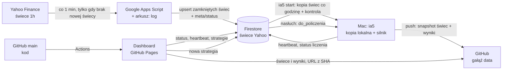

# IA5 — instrukcja projektu i żelazne zasady

> **Plik nadrzędny.** Każda sesja pracy (Claude albo człowiek) zaczyna się od przeczytania tego pliku, `docs/STATUS.md` i `docs/DECISIONS.md`.
> Żelazne zasady (sekcja 1) zmienia wyłącznie Michał — wyraźnie, w rozmowie — i każda zmiana ma wpis w `docs/DECISIONS.md`.

Wersja 0.22 · 2026-10-31 · Status: E0–E5 zbudowane (kod); uruchomienie na Macu w toku — `docs/STATUS.md`

---

## 0. Cel

IA5 to laboratorium do **szukania i weryfikowania** strategii FX na świecach godzinowych (H1).
Dashboard ma odpowiadać na dwa pytania naraz: *ile strategia by zarobiła* i *czy to nie przypadek*.

Zakres teraz: system świec + program na Macu (`ia5`) + dashboard (zakładka **Strategie**).
Zakładka **Inwestorzy** istnieje, ale jest pusta („wkrótce"). Nie budujemy jej bez polecenia.

---

## 1. ŻELAZNE ZASADY

### Dane
- **D1.** Czas zawsze w UTC. Znacznik świecy = czas jej **otwarcia** (epoch, sekundy). Świeca `13:00` zamyka się o `14:00:00`.
- **D2.** Zapisujemy wyłącznie świece zamknięte: `ts + 3600 ≤ teraz − 60 s`. Świeca w trakcie nigdy nie trafia do bazy.
- **D3.** Zapis jest idempotentny (upsert po `ts`): ponowne uruchomienie nie tworzy duplikatów. **Nigdy `arrayUnion` dla cen** — usuwa powtarzające się wartości i po cichu psuje dane.
- **D4.** Dane surowe są niezmienne. Czyszczenie (weekendowe świece, odrzucone błędy) to osobna, jawna i wersjonowana warstwa.
- **D5.** Każda świeca przechodzi kontrolę jakości (kalendarz sesji bez weekendów i świąt 24/25.12 i 31.12/1.01 — D-028): `high ≥ max(open, close)`, `low ≤ min(open, close)`, ceny > 0, `ts % 3600 == 0`, brak luk w sesji (tydzień FX: niedziela ~21/22:00 → piątek ~21/22:00 UTC, zależnie od czasu letniego w USA), test krzyżowy par (EUR/JPY ≈ EUR/USD × USD/JPY; EUR/GBP ≈ EUR/USD ÷ GBP/USD). Naruszenie = flaga w statusie, **nigdy cicha naprawa**.
- **D6.** Każdy wynik backtestu zapisuje hash danych, hash kodu strategii i `ENGINE_VERSION`. Wynik bez tych trzech pól nie istnieje.
- **D7.** **Jedno źródło cen: świece H1 Yahoo** (Apps Script → Firestore → kopia na Macu) — do backtestów, forward testów, skanera i monitoringu (D-039). Innych źródeł nie używamy ani nie doklejamy; dane z `research/` służą tylko do szukania hipotez, nigdy do liczenia wyników. Historia zaczyna się ok. 730 dni wstecz (tyle udostępnia Yahoo) i rośnie z każdą godziną.
- **D8.** Backtest liczy na kopii świec Yahoo po **warstwie czyszczenia** (`ia5/clean.py`, dane w `data/h1_ready/`, wersja w raporcie): świeca łamiąca D5 jest odrzucana; świeca poza sesją jest odrzucana, gdy to sobota/święto albo świeca płaska (Yahoo powtarza wtedy starą cenę); brak **≤ 3 godzin** przy weekendzie/święcie to **granica tygodnia** (Yahoo zaczyna i kończy tydzień inaczej niż kalendarz) — nic; inny brak ≤ 3 h → uzupełniony liniowo od zamknięcia przed nim do otwarcia po nim, znacznik `filled`; brak > 3 h → **przerwa w danych** (`gap_before`), także gdy brakuje we wszystkich parach naraz. Liczymy wszystkie pary z `COMPUTE_PAIRS` (8); para z mniej niż ~4 tygodniami świec jest pomijana. Surowa kopia (`data/yahoo/`) zostaje nietknięta; liczby odrzuconych, uzupełnionych i przerw są w raporcie.

### Backtest (model wykonania)
- **B1.** Sygnał liczony na zamknięciu świecy `t`, wejście na **open świecy `t+1`**. Nigdy po cenie, której w danej chwili nie dało się znać.
- **B2.** Strategia widzi tylko przeszłość. Przed liczeniem każda strategia przechodzi **detektor look-ahead** (sekcja 9). Niezaliczony = status `błąd: look-ahead`, bez liczenia.
- **B3.** Sygnały i poziomy TP/SL liczone na cenach świec Yahoo. Spread z tabeli (sekcja 2) odejmowany **jednorazowo** od każdej transakcji, w pipsach. Pips = `0,0001`; dla par z JPY = `0,01`. Test wrażliwości: spread × 1,5 i × 2 (sekcja 9).
- **B4.** Dźwignia **30:1** — zawsze (D-024). Wielkość pozycji = X% kapitału jako depozyt, nominał = 30 × X% kapitału. Domyślnie zawsze liczymy **X ∈ {5, 10, 15, 20, 30}%**; strategia może podać własne wartości (`SIZING`). Suma depozytów otwartych pozycji ≤ 100% kapitału, czyli łącznie nigdy ponad 30:1. Sygnał bez wolnego depozytu jest pomijany i liczony w raporcie. Szczegóły: 8.5.
- **B5.** Gdy w jednej świecy H1 mieszczą się i TP, i SL — kolejności nie znamy (Yahoo nie daje danych wewnątrz świecy), więc zawsze **SL** (pesymistycznie) i transakcja dostaje flagę `ambiguous`. Wynik z > 2% takich transakcji dostaje ostrzeżenie.
- **B6.** Luka cenowa: open za poziomem SL → wyjście po open (gorzej). Open za poziomem TP → wyjście po poziomie TP (bez zysku z luki).
- **B7.** Każdy wariant wyjścia ma SL albo limit czasu. Żadnych pozycji bez końca.
- **B8.** Jedna pozycja na parę na wariant. Sygnał przy otwartej pozycji w tej parze jest pomijany (licznik pominiętych w raporcie). Wyjątek na życzenie Michała: strategia ustawia `PYRAMID = k` — do k pozycji naraz w parze, tylko w jednym kierunku; |sygnał| = waga depozytu (D-034).
- **B9.** Wskaźniki tylko z modułu `ia5.indicators`, zweryfikowanego testami zgodności z TA-Lib. Strategie nie piszą własnych RSI/ATR.
- **B10.** Zmiana logiki silnika = podbicie `ENGINE_VERSION`. Wyniki starszej wersji dashboard oznacza jako nieaktualne.
- **B11.** Handlujemy tylko **07:00–17:00 czasu polskiego** (`Europe/Warsaw`, z czasem letnim; zimą 06–16 UTC, latem 05–15 UTC) — wtedy spready są najniższe (D-028). Wejście wyłącznie na open świecy otwartej o 07:00…16:00 czasu polskiego; sygnały poza oknem są pomijane i liczone w raporcie. **Wyjście na dowolnej świecy** — według wariantu wyjścia, także w nocy i po weekendzie; bez limitu 23:00 (D-032 zastępuje D-030). Benchmark losowych wejść (W3) losuje w tym samym oknie. Strategia może wyłączyć okno (`HOURS = False`) albo podać własne (`HOURS = (od, do)`) — tylko na wyraźne życzenie Michała (D-034).
- **B12.** Transakcja nachodząca na **przerwę w danych** (D8) (od świecy wejścia do świecy wyjścia, także przerwa między sygnałem a wejściem) albo mająca świecę sygnału, wejścia lub wyjścia **uzupełnioną** jest **anulowana** — jakby jej nie było; liczby anulowanych (osobno) w raporcie. **Weekend, święto i granica tygodnia nie są przerwą:** po ostatniej piątkowej świecy następna jest pierwsza niedzielna/poniedziałkowa. Benchmark losowy anuluje tak samo (D-031, D-032, D-039).

### Walidacja (bez niej wynik to anegdota)
- **W1.** Ostatnie **25%** historii to out-of-sample (OOS). Ranking i wybór wariantów tylko na in-sample (IS). OOS pokazujemy obok, nigdy nie służy do wyboru.
- **W2.** Raport zawsze podaje **liczbę przetestowanych wariantów** i Deflated Sharpe Ratio. Przy setkach wariantów najlepszy jest w dużej mierze szczęściarzem.
- **W3.** Każda strategia jest porównana z **benchmarkiem losowych wejść** (te same pary, ta sama liczba transakcji, te same zasady wyjścia, ≥ 1000 losowań) → percentyl.
- **W4.** Zatwierdzoną strategię można **zamrozić** (hash kodu + parametrów + data). Od tej chwili system sam liczy jej wyniki forward na nowych świecach.

### Bezpieczeństwo
- **S1.** Kod strategii wpisany na stronie wykonuje się na Macu. Dlatego: zapis strategii tylko po zalogowaniu (Firebase Auth, Google) i tylko dla UID właściciela (reguły Firestore), a runner dodatkowo sprawdza `createdBy == OWNER_UID`.
- **S2.** Kod strategii działa w osobnym procesie, z limitem czasu i pamięci, z czystymi zmiennymi środowiskowymi (bez dostępu do kluczy).
- **S3.** Żadnych sekretów w repo. Klucz service account leży w `~/.ia5/`, `.gitignore` od pierwszego commita. Konfiguracja webowa Firebase jest publiczna z natury — chronią ją reguły Firestore i ograniczenie klucza API do domeny strony.

### Budżet zasobów (darmowy plan Firebase: 50 000 odczytów i 20 000 zapisów dziennie)
- **Z1.** Świece w Firestore grupowane: **1 dokument = 1 para × 1 miesiąc**. Nigdy 1 świeca = 1 dokument (sam backfill ~100 tys. świec zjadłby 5 dni limitu zapisów).
- **Z2.** Dashboard nie czyta świec ani wyników z Firestore — czyta je z gałęzi `data` na GitHub. Z Firestore czyta tylko `meta/status`, `runner/heartbeat` i listę `strategies` (nasłuch `onSnapshot`, bez odpytywania w pętli).
- **Z3.** Liczniki (np. liczba świec) są przechowywane w `meta/status`, nigdy liczone zapytaniem.
- **Z4.** Każda nowa funkcja, która czyta lub zapisuje Firestore, ma w commicie oszacowanie dziennego zużycia.

### Strategie (K) — gdy Michał mówi „zrób mi strategię …”
- **K1.** Claude postępuje według procedury z `docs/STRATEGIE.md` (sekcja 1): interpretacje → hipoteza → `PARAMS` (≤ ~12 kombinacji) → kod według kontraktu → **kontrola `python scripts/check_strategy.py plik.py` z wynikiem OK** → odpowiedź z jednym blokiem kodu gotowym do wklejenia w dashboard.
- **K2.** Strategia definiuje wyłącznie wejścia (`signals`). Wyjścia, spread, dźwignię i wielkość pozycji liczy silnik; własne `EXITS` / `SIZING` tylko na wyraźne życzenie.
- **K3.** Claude nie podaje przewidywanych wyników strategii. Wyniki liczy Mac; ocenę robi się na raporcie według sekcji 9.

### Praca w repo (Claude)
- **G1.** Start sesji: `git pull`, przeczytaj ten plik, `docs/STATUS.md`, `docs/DECISIONS.md`.
- **G2.** Małe commity, każdy działający. **Claude sam robi push** do `origin` po każdym ukończonym kroku, bez pytania.
- **G3.** Przed pushem: testy (`pytest`) zielone, lint czysty. Czerwone testy = brak pusha.
- **G4.** Nigdy `push --force` na `main`. Nigdy nie usuwać danych ani historii danych bez zgody Michała.
- **G5.** Koniec sesji: aktualizacja `docs/STATUS.md` (zrobione / następne / znane problemy). Każda decyzja architektoniczna → wpis w `docs/DECISIONS.md` (data, decyzja, powód, odrzucone alternatywy).
- **G6.** Bez rozszerzania zakresu na własną rękę. Nowa biblioteka lub usługa spoza sekcji 10.7 i 12 → najpierw wpis w `DECISIONS.md`.
- **G7.** Instrukcja niejasna albo sprzeczna z tym plikiem → pytać, nie zgadywać.

---

## 2. Parametry rynku

| Para | Ticker Yahoo | Pips | Spread (pips) | Waluta wyniku |
|---|---|---|---|---|
| EUR/USD | `EURUSD=X` | 0,0001 | 0,9 | USD |
| USD/JPY | `JPY=X` | 0,01 | 1,4 | JPY |
| GBP/USD | `GBPUSD=X` | 0,0001 | 1,5 | USD |
| EUR/GBP | `EURGBP=X` | 0,0001 | 1,7 | GBP |
| AUD/USD | `AUDUSD=X` | 0,0001 | 1,7 | USD |
| USD/CHF | `CHF=X` | 0,0001 | 1,9 | CHF |
| USD/CAD | `CAD=X` | 0,0001 | 2,0 | CAD |
| EUR/JPY | `EURJPY=X` | 0,01 | 2,1 | JPY |

- Godziny handlu: wejścia **07:00–17:00** czasu polskiego, wyjście na dowolnej świecy (B11, D-028, D-032). Dźwignia **30:1** (B4, D-024). Waluta konta: **USD**. Kapitał startowy: **10 000 USD**.
- Wynik w walucie kwotowanej przeliczany na walutę konta po kursie z zamknięcia świecy wyjścia, z naszych własnych danych (JPY przez USD/JPY, GBP przez GBP/USD, CHF przez USD/CHF, CAD przez USD/CAD).
- Swap / rolowanie: domyślnie 0 (decyzja O5). Raport pokazuje, ile nocy przez 21:00 UTC trzymano pozycje, żeby było widać skalę pominiętego kosztu.

---

## 3. Architektura — 4 miejsca, każde z jedną rolą



| Miejsce | Rola | Pisze do | Czyta z |
|---|---|---|---|
| Google Apps Script (+ arkusz) | Pobiera świece, prowadzi log uruchomień | Firestore `candles/*`, `meta/status`; arkusz `log` | Yahoo |
| Firestore | Baza świec Yahoo (jedyne źródło cen), status, heartbeat, kolejka strategii | — | — |
| Mac (`ia5`) | Kopia świec, kontrola jakości, czyszczenie, liczenie, publikacja | Firestore `runner/heartbeat`, `strategies/*`; GitHub gałąź `data` | Firestore |
| GitHub | `main`: kod + strona (Pages). `data`: zimna kopia świec i wyniki | — | — |
| Dashboard | Podgląd i dodawanie strategii | Firestore `strategies/*` | Firestore (3 małe rzeczy), GitHub `data` |

### Przepływ

1. **Apps Script — co minutę (D-033), nie co godzinę.** Najpierw sprawdza w Script Properties, czy oczekiwana nowa świeca jest już zapisana. Jeśli tak — kończy bez żadnego zapytania. Jeśli nie — pyta Yahoo o ostatnie dni (interwał 1h), zapisuje zamknięte świece (upsert), aktualizuje `meta/status`.
   *Dlaczego:* wyzwalacz godzinowy Apps Script odpala się w dowolnej minucie godziny, więc pomiar „ile sekund zajęło pobranie świecy" byłby szumem rzędu 0–60 min.
2. **Mac — jeden proces `ia5 start` (D-039).** Na starcie i co godzinę (5 min po pełnej godzinie): kopia świec Yahoo z Firestore → kontrola aktualności i jakości (D5, trójkąty) → dane do liczenia po warstwie czyszczenia (`data/h1_ready/`, D8) → mapa pokrycia → push świec i mapy na gałąź `data` (tylko gdy się zmieniły) i SHA w `meta/status.dataSha` → przegląd zdrowia. Między synchronizacjami nasłuchuje strategii do policzenia.
3. **Dashboard.** Status z `meta/status` i `runner/heartbeat`. Świece i wyniki z gałęzi `data` przez `raw.githubusercontent.com/miszyszka/IA5/<SHA>/...` — adres z konkretnym SHA, więc bez problemu z cache.
4. **Nowa strategia.** Dashboard zapisuje `strategies/{id}` ze statusem `do_policzenia` → Mac dostaje to przez nasłuch → `liczy_sie` + postęp → wyniki na gałąź `data` → `policzona` + SHA commita.

### Pomiar latencji (to, co widać na dashboardzie)

`latencja_s = czas_zapisu_do_Firestore − (ts_otwarcia + 3600)`

To uczciwa liczba od końca do końca: obejmuje też opóźnienie, z jakim Yahoo publikuje świecę. Dashboard pokazuje ostatnią wartość, medianę z 24 h i mini-wykres.

---

## 4. Model danych

### Firestore

```
candles/{PARA}_{RRRR-MM}            np. candles/EURUSD_2026-10
  pair: "EURUSD", month: "2026-10"
  bars: { "1793016000": [o, h, l, c], ... }      # klucz = ts otwarcia
  updatedAt

meta/status
  lastRun: { startedAt, finishedAt, ok, error }
  daily:   { "2026-10-26": { EURUSD: 19, ... }, ... }   # dziennik: świece w bazie wg dnia świecy, 60 dni
  recent:  { start, pairs: { EURUSD: "111l1.f…" } }       # audyt świeca po świecy, 3 tygodnie: 1 jest, l spóźniona, f flaga, . brak (D-027)
  pairs:   { EURUSD: { lastTs, latencySec, count, flags[] }, ... }
  totalBars, latency24h[], dataSha
  health:  { at, state, summary, facts[], checks: [{ id, name, state, text, detail[], fix }] }   # przegląd zdrowia z Maca (D-023)

runner/heartbeat
  lastSeen, state: idle|syncing|computing|offline,
  job: { id, progress, eta }, version, host

strategies/{id}
  name, hypothesis, code, status, createdAt, createdBy,
  engineVersion, frozenAt?, result?: { sha, path, summary }, error?
```

- Zapis świec: REST `PATCH` z `updateMask` na pojedyncze klucze mapy `bars` → bez odczytu przed zapisem, idempotentnie.
- Wyłączyć indeksowanie pola `bars` (wyjątek indeksu pojedynczego pola) — taniej i z dala od limitu 40 000 wpisów indeksu na dokument.
- Rozmiar: ~744 świece × 4 liczby ≈ 30 KB na dokument (limit 1 MiB). Backfill: 8 par × ~25 miesięcy ≈ 200 zapisów.
- Statusy strategii: `do_policzenia` → `liczy_sie` → `policzona` | `blad` ; opcjonalnie `zamrozona`.

### Reguły Firestore

Aktualne reguły: [`firestore.rules`](firestore.rules) (wklejane w Firebase → Firestore → Rules, z `<OWNER_UID>` zamienionym na UID Michała). Zasada: `meta/*` i `runner/*` czyta każdy (pasek statusu), piszą tylko Apps Script i Mac; `candles/*` czyta właściciel; `strategies/*` czyta i zmienia wyłącznie właściciel, tworzyć można tylko ze statusem `do_policzenia` albo `do_usuniecia`, zmieniać tylko pola `name, hypothesis, code, status, frozenAt, frozenVariant`.

Apps Script i Mac działają na uprawnieniach administracyjnych (OAuth właściciela / service account) i reguł nie potrzebują.

### GitHub, gałąź `data` (osobna, bez historii kodu)

```
candles/{PARA}/{RRRR}.parquet        # H1 z Yahoo (surowa kopia): ts, open, high, low, close; zmienia się tylko bieżący rok
candles/manifest.json                # hash, liczba świec, zakres per para
coverage/coverage.json               # mapa pokrycia (D-022): para × miesiąc, luki jako zakresy — same liczniki, bez cen
results/index.json                   # lista policzonych strategii (dashboard)
results/{strategyId}/                # ostatni run strategii (poprzedni jest w historii gita)
  manifest.json     # hash danych, hash kodu, ENGINE_VERSION, źródło, opis czyszczenia, zakres, liczba wariantów, pominięte
  variants.json     # metryki per wariant + zakres wierszy w trades.parquet (row_start, row_end)
  trades.parquet    # wszystkie transakcje wszystkich wariantów, posortowane po wariancie (dashboard czyta tylko potrzebny fragment)
  validation.json   # DSR, PBO, benchmark losowy, walk-forward, bootstrap, test spreadu, kapitał, werdykt
  candles/{PARA}.parquet  # wszystkie świece użyte w liczeniu (po czyszczeniu) — do wykresu
  report.md         # raport dla Claude (sekcja 10.6)
  strategy.py       # kod strategii
scans/{run}/                         # wyniki skanera hipotez (D-037)
```

### Lokalnie na Macu (poza repo)

```
~/.ia5/
  service-account.json                     # klucz Firebase (S3)
  config.json                              # {"owner_uid": "..."} — kto może zlecać liczenie (S1)
  source.json                              # {"source": "yahoo"} — znacznik po przejściu na jedno źródło (D-039)
  data/yahoo/{PARA}.parquet                # surowa kopia świec z Firestore — niezmieniana (D4)
  data/h1_ready/{PARA}.parquet + .json     # po warstwie czyszczenia (filled, gap_before) + opis — jedyne wejście silnika i skanera (D8)
  data-repo/                               # lokalny klon gałęzi data
  results/{id}/{run}/  scans/{run}/        # wyniki liczenia i skanów (to samo trafia na gałąź data)
```

---

## 5. Google Apps Script

- Kod w repo `apps_script/`, synchronizowany narzędziem `clasp`. Nie edytujemy tylko w przeglądarce.
- Funkcje:
  - `backfill()` — jednorazowo, i gdy przegląd zdrowia pokaże przerwy w danych. Yahoo udostępnia świece 1h tylko z ostatnich **730 dni** — to cała dostępna historia; dalej rośnie o każdą nową godzinę (D7). Ponowny backfill uzupełnia dziury, jeśli Yahoo ma już te świece (upsert, ok. 200 zapisów). Zapis porcjami po miesiącu.
  - `tick()` — wyzwalacz **co 1 min** (D-033). Gdy wszystko jest — koniec bez zapytań. Tuż po pełnej godzinie czeka na zamknięcie świecy (D2) i ponawia brakujące pary co 15 s przez 10 min (najwyżej 100 s na uruchomienie); status zapisuje po każdej rundzie z nową świecą. Po wklejeniu nowej wersji uruchom raz `installTrigger()`.
  - `healthcheck()` — ręczna diagnostyka.
- Yahoo: nieoficjalny endpoint `v8/finance/chart`, `interval=1h`. Ponawianie z rosnącym odstępem, maks. 3 próby, nigdy pętla bez końca. Odpowiedź, która nie jest JSON-em → błąd w `meta/status`, nie awaria.
- Odrzucamy ostatnią, niezamkniętą świecę (D2). Nadpisujemy 3 ostatnie zamknięte (Yahoo czasem je koryguje). Korekta > 0,5 pipsa → flaga `revised`.
- Zapis do Firestore przez REST z tokenem `ScriptApp.getOAuthToken()` (zakres `datastore`).
- Arkusz: zakładka `log` — wiersz na uruchomienie (czas, para, nowe świece, latencja, błąd). Tania druga linia diagnostyki.
- Ryzyko: Yahoo nie ma oficjalnego API i potrafi zmienić lub przyciąć nieoficjalne zapytania; to jedyne źródło (D7), więc awaria Yahoo zatrzymuje dopływ nowych świec — historia na Macu i liczenie działają dalej, a przerwa jest oznaczona w danych (B12). Na danych 2024–2026 Yahoo miało 3 takie przerwy (26 h, 6 h, 66 h, wszystkie pary naraz). Plan B — wpis w `DECISIONS.md`, gdy będzie potrzebny.

---

## 6. Program na Macu (`ia5`)

- Python 3.12, menedżer `uv`. Instalacja: `uv tool install -e runner` → w terminalu działa komenda `ia5`.
- `ia5 start` — **jedyny proces** (D-039): najpierw weryfikuje aktualność danych, potem nasłuchuje strategii do policzenia.
  1. Pierwszy start po D-039: usuwa z `~/.ia5` dane Dukascopy i policzone na nich wyniki, z gałęzi `data` wyniki i skany policzone na Dukascopy (historia gita zostaje), a policzone strategie wysyła do ponownego liczenia na świecach Yahoo (zgoda Michała z 2026-10-31).
  2. Stan bazy (`meta/status`), kopia świec Yahoo z Firestore (pierwszy raz pełna, potem miesiące od ostatniej świecy kopii — po przerwie Maca kopia nie ma dziur).
  3. Kontrola aktualności (czy każda para ma ostatnią zamkniętą świecę sesji) i jakości (D5, trójkąty par).
  4. Dane do liczenia (`data/h1_ready/`, warstwa czyszczenia D8) — przebudowa pary tylko, gdy zmieniły się jej świece.
  5. Mapa pokrycia (D-022) i push na gałąź `data` świec oraz `coverage/coverage.json` (każde tylko, jeśli coś się zmieniło); przegląd zdrowia (D-023) → `meta/status.health`.
  6. Heartbeat co 30 s do `runner/heartbeat`; `caffeinate -i`, żeby Mac nie usnął.
  7. Nasłuch `strategies` ze statusem `do_policzenia` / `do_usuniecia`; kolejka FIFO, jedna strategia na raz.
  8. Co godzinę (5 min po pełnej godzinie) kroki 2–5 od nowa; co 6 h ponowne liczenie zamrożonych strategii (forward test, W4).
  9. `Ctrl+C` → heartbeat `offline`, czyste wyjście.
- `ia5 scan [--duzy] [--pary …]` — **skaner hipotez** (D-037): tysiące–miliony prostych reguł na wszystkich parach, FDR 5% w odkryciu (pierwsze 50%), potwierdzenie (50–75%), ostatnie 25% pominięte; wynik `~/.ia5/scans/{run}/` i gałąź `data` `scans/{run}/`. To hipotezy do zbudowania strategii, nie werdykt.
- Pozostałe komendy (pomocnicze, na kopii lokalnej): `ia5 health` (opisowy raport zdrowia w terminalu + zapis na dashboard), `ia5 status`, `ia5 run <plik.py>` (liczenie lokalne, bez dashboardu; wyniki w `~/.ia5/results/{nazwa}/{run}/`), `ia5 check <plik.py>`.
- Dashboard pokazuje „połączony", gdy `teraz − lastSeen < 90 s`.

### Protokół dashboard ↔ Mac (jedyna droga komunikacji: Firestore `strategies/{id}` + gałąź `data`)

| Krok | Kto | Zapis | Odczyt |
|---|---|---|---|
| Nowa strategia | dashboard (zalogowany właściciel) | `strategies/{id}`: `name, hypothesis, code, status="do_policzenia", createdBy, createdAt` | Mac: nasłuch `status in [do_policzenia, do_usuniecia]` |
| Start liczenia | Mac | `status="liczy_sie"`; `runner/heartbeat.job = {id, name, progress, phase}` | dashboard: pasek postępu |
| Wynik | Mac | push `results/{id}/` + `results/index.json` na gałąź `data`; `status="policzona"`, `result={sha, path, run_id, verdict}` | dashboard: odświeża SHA gałęzi `data`, karta strategii |
| Błąd | Mac | `status="blad"`, `error` (kontrakt, look-ahead, wyjątek) | dashboard: komunikat + „Popraw kod” |
| Popraw / policz ponownie | dashboard | `code, hypothesis, status="do_policzenia"` (tworzy dokument, gdy strategia była tylko na gałęzi `data`) | Mac jak wyżej |
| Usunięcie | dashboard | `status="do_usuniecia"` — strategia znika z listy od razu | Mac: usuwa `results/{id}/` i wpis z indeksu, potem dokument |
| Zamrożenie | dashboard | `frozenAt, frozenVariant` | Mac: co 6 h przelicza; karta: filtr „tylko forward” |

Reguły Firestore (`firestore.rules`) pozwalają na te zapisy wyłącznie właścicielowi (S1); Mac dodatkowo sprawdza `createdBy == owner_uid` z `~/.ia5/config.json`.

---

## 7. Kontrakt strategii (to wpisuję w okno dialogowe)

**Pełny przewodnik i reguła dla Claude: [`docs/STRATEGIE.md`](docs/STRATEGIE.md)** — kontrakt, lista funkcji `ind`, wzorce, pułapki look-ahead, procedura „zrób mi strategię”. Wzorce działające: `strategies/examples/` (sprawdzane w CI).

```python
HYPOTHESIS = """Dlaczego to działa — spisane PRZED liczeniem."""
PARAMS = {"rsi_level": [25, 30, 35], "slope_bars": [5, 20]}   # każda kombinacja = wariant wejścia

def signals(df, p, ind):          # df: H1 jednej pary, indeks UTC = czas otwarcia; p: jedna kombinacja PARAMS
    trend_up = ind.rising(ind.sma(df.close, 200), p["slope_bars"])   # „SMA200 rośnie”
    oversold = ind.cross_below(ind.rsi(df.close, 14), p["rsi_level"])  # zdarzenie, nie stan
    return (trend_up & oversold).astype("int8")                       # +1 long / −1 short / 0
```

Egzekwowanie: `runner/ia5/sandbox.py` (osobny proces, dozwolone importy `numpy`, `pandas`, `math`), detektor look-ahead (cięcia danych + zaburzenie przyszłości), `ia5 check` / `scripts/check_strategy.py`, kontrola w edytorze dashboardu.

---

## 8. Silnik backtestu

### 8.1 Wejścia
Domyślnie open świecy `t+1`, tylko w oknie 07:00–17:00 czasu polskiego (B11). Opcjonalne warianty: opóźnienie o k świec; potwierdzenie (następna świeca zamyka się w kierunku sygnału).

### 8.2 Domyślna siatka wyjść (~230 wariantów)
- **Czasowe:** wyjście po N świecach, N ∈ {1, 2, 3, 4, 6, 8, 12, 16, 24, 36, 48, 72, 96, 120}.
- **ATR:** ATR(n), n ∈ {5, 14}, liczony na świecach przed wejściem; TP ∈ {0,5; 0,75; 1; 1,5; 2; 3; 4} × ATR; SL ∈ {0,5; 1; 1,5; 2; 3} × ATR; limit czasu ∈ {24, 72, 120} świec.
- **Na życzenie strategii (`EXITS`):** `rsi_streak` — RSI14 przez N zamknięć z rzędu po złej stronie poziomu → wyjście na open następnej (D-034); `trail` — stop kroczący `trail`×ATR od najwyższego high poprzednich świec, ze stopem początkowym (D-035). Limit czasu w `EXITS` do 480 świec.
- **Wskaźnikowe:** RSI(14) dochodzi do 50 (long ≥ 50, short ≤ 50); przecięcie SMA; sygnał przeciwny. Każde z SL ∈ {1, 2, 3} × ATR(14) i limitem 120 świec.

### 8.3 Liczenie
Wejścia liczone raz; wszystkie wyjścia na tych samych wejściach. numpy wektorowo + numba dla pętli wyjść. Cel: strategia na 8 parach liczy się w minutach, nie godzinach.

### 8.4 Zapis transakcji
Pips brutto, pips netto (− spread), R (względem SL; dla wyjść bez SL — względem 1 × ATR(14)), MAE, MFE, liczba świec, powód wyjścia, `ambiguous`, IS/OOS.

### 8.5 Portfel i kapitał
- Najpierw przewaga transakcji (pips, R) — niezależna od wielkości pozycji. Osobno symulacja kapitału — zależna od wielkości pozycji.
- Wielkość pozycji (B4): depozyt = X% bieżącego kapitału, nominał = 30 × depozyt, procent składany przy wejściu. Domyślnie liczymy wszystkie X ∈ {5, 10, 15, 20, 30}%; strategia może podać własną listę w `SIZING`.
- Limit: suma depozytów otwartych pozycji ≤ 100% kapitału. Przy X = 30% to najwyżej 3 pozycje naraz; czwarty sygnał jest pomijany i liczony. Dzięki temu łącznie nigdy ponad 30:1. Kapitał może spaść do zera lub poniżej (brak modelu stop-out brokera) — wtedy nowe wejścia są pomijane.
- Wynik w USD: zysk w walucie kwotowanej przeliczany po kursie z zamknięcia świecy wyjścia (sekcja 2).
- W karcie strategii wielkość pozycji to **przełącznik**, nie kolejne warianty w rankingu. Ranking, DSR i PBO liczymy na przewadze transakcji (R), żeby wielkość pozycji nie mnożyła liczby prób.
- Kapitał przeliczany także w przeglądarce, gdy wyłączasz pary w filtrach.

### 8.6 Metryki
Liczba transakcji, win rate, średni zysk i strata, profit factor, expectancy (pips, R, %), CAGR, maksymalne obsunięcie, czas pod wodą, Sharpe i Sortino (z dziennych zwrotów), Calmar, najdłuższa seria strat, ekspozycja (% czasu w rynku), t-stat średniej transakcji.
Rozbicia: para, rok, kierunek, sesja (Azja 00–07, Europa 07–13, USA 13–21 UTC), dzień tygodnia.

---

## 9. Walidacja — kto poza nami mówi, że wynik jest prawdziwy

| Co sprawdzamy | Niezależny sędzia | Kiedy |
|---|---|---|
| Wskaźniki | TA-Lib — zgodność do 1e-9 | CI, każdy push |
| Silnik | Ręcznie policzone „złote" scenariusze na syntetycznych świecach; testy własności (`hypothesis`), np. netto = brutto − spread zawsze | CI |
| Silnik vs inny silnik | `backtesting.py` na strategii referencyjnej (przecięcie SMA + wyjście po N świecach) — identyczna lista transakcji. Ręcznie: TradingView Strategy Tester | CI / raz na etap |
| Dane | Przegląd zdrowia (D-023): świeżość Yahoo, kopia na Macu = Firestore, trójkąty par godzina po godzinie na całej historii (przesunięcie czasu jednej pary daje ~11% godzin ponad próg), zamrożone notowania w sesji, kompletność i przerwy, poprawność świec | każda synchronizacja (co godzinę) |
| Look-ahead | Detektor: sygnały liczone na pełnych danych i na danych obciętych w losowych punktach muszą być identyczne do punktu cięcia | przed każdym liczeniem |
| Przeuczenie | OOS 25% (W1), walk-forward (okna roczne), Deflated Sharpe Ratio, PBO metodą CSCV (16 bloków), bootstrap 95% CI expectancy | każde liczenie |
| Przypadek | Benchmark losowych wejść, ≥ 1000 losowań → percentyl (W3) | każde liczenie |
| Stabilność | Heatmapa TP × SL — szukamy płaskowyżu, nie pojedynczego piku; wynik przy spreadzie × 1,5 i × 2 | każde liczenie |
| Rzeczywistość | Forward test po zamrożeniu (W4) | automatycznie, z każdą nową świecą |

**Werdykt w karcie** (progi ustalone z góry, do kalibracji w DECISIONS):
🟢 gdy jednocześnie: expectancy netto OOS > 0, percentyl benchmarku ≥ 95, PBO < 0,3, DSR ≥ 0,95, wynik dodatni przy spreadzie × 1,5.
🟡 gdy część warunków. 🔴 gdy OOS ≤ 0 albo percentyl < 80.

---

## 10. Dashboard

### 10.1 Stan systemu (zawsze widoczny, w nagłówku obok zakładek)
- **Dane** i **Mac** — dwa wskaźniki tuż obok siebie, każdy z kropką stanu (jedyne świecące elementy strony; przy działającym systemie kropka lekko „oddycha”).
  - Dane: działa / opóźnienie / stoi / rynek zamknięty / otwarcie tygodnia (weekend i pierwsze ≤ 3 h po nim to nie awaria, D-039); obok ostatnia świeca i odliczanie do następnej. Gdy wybije pełna godzina — **czerwony zegar** (ile par czeka, od pełnej godziny), aż wszystkie pary mają nową świecę (D-033). Progi w godzinach rynku: OPÓŹNIENIE gdy świecy brak > 20 min po zamknięciu, STOI gdy > 75 min.
  - Mac: połączony / sprawdza dane / liczy (nazwa, postęp %) / rozłączony (od kiedy).
- **Problemy** — liczba kontroli przeglądu zdrowia, które nie są OK (bursztyn: uwagi, czerwień: błąd); pojawia się tylko, gdy są (klik → Stats).
- **Pary** — jeden symboliczny kafelek („8 par” + kody walut), bez danych i bez rozwijania.
- Bez kafli KPI. Liczby (świece w bazie, latencja, flagi, pary) są w zakładce **Stats**.

### 10.2 Zakładki
**Strategie** | **Stats** | **Inwestorzy** (pusta, „wkrótce").

**Stats** (`meta/status` + `runner/heartbeat` + `coverage/coverage.json` z gałęzi `data`, 0 dodatkowych odczytów Firestore): **Stan systemu** (D-023) — jedno zdanie o stanie, opis bazy i projektu (ile świec w którym źródle, zakresy, strategie, gałąź `data`) i lista nazwanych kontroli (✓ / ! / ✕) z opisem, szczegółami i „co zrobić”; gdy przegląd jest starszy niż 2 h, strona mówi to wprost; świece w bazie i ostatnie pobranie, latencja (ostatnia, mediana 24 h, mini-wykres), kafelek przeglądu z listą wszystkich problemów (nazwa + zdanie);
**mapa pokrycia świec Yahoo** (D-022, D-033, D-039) z przełącznikiem: *Ostatnia doba* — 24 zamknięte świece + trwająca godzina (przerywana kratka), nad kolumną godzina otwarcia w czasie polskim; stany: jest / spóźniona > 20 min / z flagą / czeka (czerwony zegar od pełnej godziny do zapisu) / rynek zamknięty; przy każdej parze zegar albo czas ostatniego zapisu; na żywo z `meta/status.recent` i `pairs`; *Cała historia* — 8 par × miesiące od pierwszej świecy: kolor = jak duże dziury, luki rozdzielone na *dziury* (brak danych: ≤ 3 h uzupełniana do liczenia, dłuższa = przerwa, transakcje anulowane), *granicę tygodnia* i *bez ruchu ceny*; klik miesiąc → lista luk co do godziny ze skutkiem dla liczenia, klik para → wszystkie jej dziury; **dziennik dzień po dniu** — z ostatnich 30 dni, ile świec przybyło każdego dnia (wg dnia świecy, UTC) wobec oczekiwanych z kalendarza sesji, per para, z brakami na kolor; tabela par. Flagi Yahoo nie mają osobnej listy — widać je w audycie jako kafelki „z flagą”, a ich liczbę w przeglądzie zdrowia.

### 10.3 Lista strategii
Nazwa, status (do policzenia / liczy się x% / policzona / błąd / zamrożona), data, werdykt, kluczowe liczby najlepszego wariantu IS obok OOS.

### 10.4 Nowa strategia
Duże okno: nazwa, hipoteza, kod (pole tekstowe z czcionką o stałej szerokości, Tab = 4 spacje, Ctrl/⌘+Enter = wyślij). Kontrola kontraktu na żywo (`checkStrategyCode`) blokuje wysłanie przy błędzie. Szablon startowy. Zapis → status `do_policzenia`.

### 10.5 Karta strategii
- Nagłówek: werdykt, hipoteza, liczba wariantów, `ENGINE_VERSION`, zakres danych, hashe.
- **Filtry globalne karty:** pary (checkboxy), kierunek, okres, IS / OOS / całość, rodzina wyjść, sesja, wielkość pozycji (5 / 10 / 15 / 20 / 30% lub z `SIZING`).
- **Ranking wariantów:** tabela sortowalna + paski metryki (styl z inspiracji 3).
- **Heatmapa TP × SL** (rodzina ATR) i krzywa expectancy względem N (rodzina czasowa).
- **Kapitał od początku** dla wybranego wariantu: granica IS/OOS, data zamrożenia, obsunięcie pod spodem, pasmo benchmarku losowego (mediana i 5–95%).
- **Wykres świecowy ze wszystkimi transakcjami:** markery wejścia i wyjścia, linie TP/SL, kolor wg wyniku, przełączanie par; klik w tabeli transakcji → skok na wykresie.
- **Tabela transakcji** z filtrami i eksportem CSV.
- **Rozbicia:** para, rok, sesja, dzień tygodnia.
- **Walidacja:** DSR, PBO, percentyl benchmarku, przedział bootstrap, test spreadu, % `ambiguous`.
- Przyciski: **Kopiuj raport dla Claude**, **Pobierz report.md**, **Zamroź strategię**, **Policz ponownie**.

### 10.6 Raport dla Claude (`report.md`)
Stała struktura: hipoteza → kod → dane (zakres, pary, koszty, model wykonania) → liczba wariantów → top 10 wariantów IS z ich wynikami OOS → stabilność (sąsiedzi najlepszego wariantu na siatce) → walidacja → rozbicia → najgorsze obsunięcia → znane ograniczenia (źródło danych, brak swapów, pesymizm w niejednoznacznej świecy) → pytania do recenzenta.
Liczby w tabelach markdown, bez obrazków — tak, żeby model mógł je czytać.

### 10.7 Technologia
Statyczny HTML + moduły ES, bez kroku budowania (`web/`). Biblioteki w repo (`web/vendor/`, bez zależności od CDN): ECharts 5.5 (kapitał, heatmapy, krzywe), Lightweight Charts 4.2 (świece z transakcjami), hyparquet 1.31 (czytanie fragmentów Parquet zakresami HTTP — tylko wiersze wybranego wariantu). Firebase JS SDK 10.14 ładowany dynamicznie z gstatic — gdy zawiedzie, wyniki z GitHub nadal działają. Logika obliczeń w `web/js/metrics.js` testowana w Node (`tests/web`), kapitał zgodny z `runner/ia5/portfolio.py`. Wdrażanie przez GitHub Actions → Pages. Test w przeglądarce: parametry `?data=<url>&nofb=1`.

---

## 11. Design (D-019)

- Tło `#0A0E13`, panele `#0F141A`, uniesione elementy `#151B23`, obramowanie 1 px `#1C232D`. Zaokrąglenia: panele 8 px, kontrolki 6 px, wskaźniki stanu w pełni zaokrąglone.
- **Płasko:** bez gradientów i bez dekoracyjnych cieni — także na wykresach.
- **Jeden akcent** — pomarańczowy `#FF7A1A` — tylko dla tego, co *wybrane*: aktywna zakładka, główny przycisk, zaznaczony wiersz/filtr, linia kapitału.
- **Kolory stanu tylko jako stan:** zielony `#3DDC84` (działa, zysk), bursztyn `#F5A524` (opóźnienie, braki, flagi), czerwony `#FF4D4F` (stoi, błąd, strata), szary (rynek zamknięty, rozłączony). Żadnych innych kolorów (bez niebieskiego dla informacji).
- **Poświata tylko na kropkach stanu** w nagłówku — jedyna „żywa” rzecz na stronie, więc coś znaczy. Ruch („oddychanie”) tylko przy działającym systemie, wyłączony przy `prefers-reduced-motion`.
- Etykiety (DEMO, zamrożona, w kolejce) jako obrys, bez wypełnień; kolor tylko gdy niesie stan.
- Liczby: JetBrains Mono z cyframi tabelarycznymi. Tekst: Inter.
- **Zasada uczciwości wykresów:** dekoracja nigdy nie zmienia danych. Ceny i kapitał bez wygładzania krzywych. Zysk i strata zawsze ze znakiem, nie tylko kolorem.

---

## 12. Struktura repo

```
IA5/
├─ CLAUDE.md                 # ten plik
├─ docs/
│  ├─ STATUS.md              # stan prac, aktualizowany co sesję
│  ├─ DECISIONS.md           # dziennik decyzji
│  ├─ STRATEGIE.md           # jak pisać strategie + reguła „zrób mi strategię” (K1–K3)
│  └─ SETUP.md               # kroki do kliknięcia
├─ web/                      # dashboard (GitHub Pages): index.html, css/, js/ (app, list, card, charts, editor,
│                            #   status, stats, session, coverage, health, data, fb, metrics, util, config), vendor/
├─ scripts/                  # check_strategy.py (kontrola kodu bez danych Michała), demo.py
├─ research/                 # badania hipotez na niezależnych danych, przed strategią (D-036)
├─ apps_script/              # Code.gs + appsscript.json (clasp)
├─ runner/                   # program na Maca
│  ├─ pyproject.toml
│  └─ ia5/  cli.py  config.py  session.py  store.py
│           quality.py  clean.py  ready.py  coverage.py  health.py  cloud.py  publish.py   # dane (E2)
│           indicators.py  engine.py  sandbox.py  backtest.py  report.py # silnik (E3)
│           validate.py  portfolio.py  check.py                           # walidacja, kapitał, kontrola (E5)
│           scan.py                                                       # skaner hipotez (D-037)
├─ tests/                    # wskaźniki vs TA-Lib, złote scenariusze, zgodność z backtesting.py, walidacja,
│                            #   strategie, publikacja, przykłady, web/ (Node)
├─ strategies/examples/
├─ firestore.rules
└─ .github/workflows/        # ci.yml (pytest, lint), pages.yml
```

Gałąź `data` — osobna, tylko dane (sekcja 4).

---

## 13. Etapy

| Etap | Zakres | Gotowe, gdy |
|---|---|---|
| **E0** Infrastruktura | Repo, ten plik, CI, `.gitignore`, reguły Firestore, Auth, gałąź `data` | CI zielone, reguły wdrożone |
| **E1** Świece | Apps Script: backfill, tick, status, log; kontrola jakości | 8 par w bazie, latencja widoczna, 0 duplikatów, test krzyżowy zielony |
| **E2** Mac | `ia5 start`: kopia świec Yahoo, kontrola, warstwa czyszczenia, Parquet, heartbeat, kolejka | Dashboard pokazuje „połączony" i postęp; 8 par lokalnie |
| **E3** Silnik | Wskaźniki + zgodność z TA-Lib, wejścia, siatka wyjść, złote testy, zgodność z backtesting.py | Wszystkie testy zielone |
| **E4** Dashboard | Status, lista, nowa strategia, karta, raport | Pierwsza strategia policzona od wpisania do raportu |
| **E5** Walidacja | OOS, walk-forward, benchmark losowy, DSR, PBO, zamrażanie + forward | Werdykt w karcie |
| **E6** Inwestorzy | Później, osobna specyfikacja | — |

Każdy etap: testy zielone → push → `STATUS.md` zaktualizowany → działa na żywej stronie. Aktualny stan etapów: `docs/STATUS.md`.

**Do kliknięcia przez Michała w E0** (Claude prowadzi krok po kroku): włączenie Firestore, włączenie logowania Google w Firebase Auth (+ domena `miszyszka.github.io`), klucz service account do `~/.ia5/`, ograniczenie klucza API do domeny strony w Google Cloud Console, projekt Apps Script podpięty pod arkusz, włączenie GitHub Pages przez Actions.

---

## 14. Decyzje

| Nr | Pytanie | Decyzja (2026-10-26) |
|---|---|---|
| O1 | Waluta konta | **USD** |
| O2 | Wielkość pozycji przy kilku pozycjach naraz | **Zależy od strategii** (`SIZING`); domyślnie zawsze **5, 10, 15, 20, 30%** kapitału jako depozyt (B4, 8.5) |
| O3 | Repo publiczne → wyniki i kod strategii widzi każdy | **Publiczne są OK** |
| O4 | Źródło danych | **Tylko świece H1 Yahoo** (D-039, 2026-10-31; wcześniejsza decyzja o Dukascopy wycofana — dane uznane za niewiarygodne) |

Otwarte:

| Nr | Pytanie | Domyślnie, do czasu decyzji |
|---|---|---|
| O5 | Swapy | 0, pokazywana skala pominięcia |
