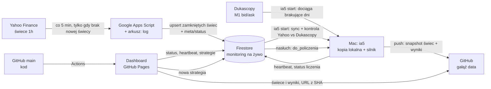

# IA5 — instrukcja projektu i żelazne zasady

> **Plik nadrzędny.** Każda sesja pracy (Claude albo człowiek) zaczyna się od przeczytania tego pliku, `docs/STATUS.md` i `docs/DECISIONS.md`.
> Żelazne zasady (sekcja 1) zmienia wyłącznie Michał — wyraźnie, w rozmowie — i każda zmiana ma wpis w `docs/DECISIONS.md`.

Wersja 0.2 · 2026-10-26 · Status: zatwierdzone decyzje O1–O4 (sekcja 14)

---

## 0. Cel

IA5 to laboratorium do **szukania i weryfikowania** strategii FX na świecach godzinowych (H1).
Dashboard ma odpowiadać na dwa pytania naraz: *ile strategia by zarobiła* i *czy to nie przypadek*.

Zakres teraz: system świec + program na Macu (`ia5`) + dashboard (zakładka **Strategie**).
Zakładka **Inwestorzy** istnieje, ale jest pusta („wkrótce"). Nie budujemy jej bez polecenia.

---

## 1. ŻELAZNE ZASADY

### Dane
- **D1.** Czas zawsze w UTC. Znacznik świecy = czas jej **otwarcia** (epoch, sekundy). Świeca `13:00` zamyka się o `14:00:00`.
- **D2.** Zapisujemy wyłącznie świece zamknięte: `ts + 3600 ≤ teraz − 60 s`. Świeca w trakcie nigdy nie trafia do bazy.
- **D3.** Zapis jest idempotentny (upsert po `ts`): ponowne uruchomienie nie tworzy duplikatów. **Nigdy `arrayUnion` dla cen** — usuwa powtarzające się wartości i po cichu psuje dane.
- **D4.** Dane surowe są niezmienne. Czyszczenie (weekendowe świece, odrzucone błędy) to osobna, jawna i wersjonowana warstwa.
- **D5.** Każda świeca przechodzi kontrolę jakości: `high ≥ max(open, close)`, `low ≤ min(open, close)`, ceny > 0, `ts % 3600 == 0`, brak luk w sesji (tydzień FX: niedziela ~21/22:00 → piątek ~21/22:00 UTC, zależnie od czasu letniego w USA), test krzyżowy par (EUR/JPY ≈ EUR/USD × USD/JPY; EUR/GBP ≈ EUR/USD ÷ GBP/USD). Naruszenie = flaga w statusie, **nigdy cicha naprawa**.
- **D6.** Każdy wynik backtestu zapisuje hash danych, hash kodu strategii i `ENGINE_VERSION`. Wynik bez tych trzech pól nie istnieje.
- **D7.** Dwa źródła, dwie role, bez sklejania. **Dukascopy M1 bid/ask** = jedyne źródło danych do backtestów i forward testów. **Yahoo → Firestore** = bieżący monitoring (status, latencja) i niezależna kontrola danych. Nigdy nie łączymy dwóch źródeł w jednej serii cen.

### Backtest (model wykonania)
- **B1.** Sygnał liczony na zamknięciu świecy `t`, wejście na **open świecy `t+1`**. Nigdy po cenie, której w danej chwili nie dało się znać.
- **B2.** Strategia widzi tylko przeszłość. Przed liczeniem każda strategia przechodzi **detektor look-ahead** (sekcja 9). Niezaliczony = status `błąd: look-ahead`, bez liczenia.
- **B3.** Sygnały i poziomy TP/SL liczone na cenie środkowej (mid = (bid + ask) / 2). Spread z tabeli (sekcja 2) odejmowany **jednorazowo** od każdej transakcji, w pipsach. Pips = `0,0001`; dla par z JPY = `0,01`. Faktyczny spread z danych bid/ask służy tylko jako test wrażliwości (sekcja 9).
- **B4.** Dźwignia **1:5**. Wielkość pozycji = X% kapitału jako depozyt, nominał = 5 × X% kapitału. Domyślnie zawsze liczymy **X ∈ {5, 10, 15, 20, 30}%**; strategia może podać własne wartości (`SIZING`). Suma depozytów otwartych pozycji ≤ 100% kapitału, czyli łącznie nigdy ponad 1:5. Sygnał bez wolnego depozytu jest pomijany i liczony w raporcie. Szczegóły: 8.5.
- **B5.** Gdy w jednej świecy H1 mieszczą się i TP, i SL → kolejność rozstrzygamy na świecach **M1** (Dukascopy). Gdy oba poziomy padają w tej samej minucie → **SL** (pesymistycznie) i transakcja dostaje flagę `ambiguous`. Wynik z > 2% takich transakcji dostaje ostrzeżenie.
- **B6.** Luka cenowa: open za poziomem SL → wyjście po open (gorzej). Open za poziomem TP → wyjście po poziomie TP (bez zysku z luki).
- **B7.** Każdy wariant wyjścia ma SL albo limit czasu. Żadnych pozycji bez końca.
- **B8.** Jedna pozycja na parę na wariant. Sygnał przy otwartej pozycji w tej parze jest pomijany (licznik pominiętych w raporcie).
- **B9.** Wskaźniki tylko z modułu `ia5.indicators`, zweryfikowanego testami zgodności z TA-Lib. Strategie nie piszą własnych RSI/ATR.
- **B10.** Zmiana logiki silnika = podbicie `ENGINE_VERSION`. Wyniki starszej wersji dashboard oznacza jako nieaktualne.

### Walidacja (bez niej wynik to anegdota)
- **W1.** Ostatnie **25%** historii to out-of-sample (OOS). Ranking i wybór wariantów tylko na in-sample (IS). OOS pokazujemy obok, nigdy nie służy do wyboru.
- **W2.** Raport zawsze podaje **liczbę przetestowanych wariantów** i Deflated Sharpe Ratio. Przy setkach wariantów najlepszy jest w dużej mierze szczęściarzem.
- **W3.** Każda strategia jest porównana z **benchmarkiem losowych wejść** (te same pary, ta sama liczba transakcji, te same zasady wyjścia, ≥ 1000 losowań) → percentyl.
- **W4.** Zatwierdzoną strategię można **zamrozić** (hash kodu + parametrów + data). Od tej chwili system sam liczy jej wyniki forward na nowych świecach.

### Bezpieczeństwo
- **S1.** Kod strategii wpisany na stronie wykonuje się na Macu. Dlatego: zapis strategii tylko po zalogowaniu (Firebase Auth, Google) i tylko dla UID właściciela (reguły Firestore), a runner dodatkowo sprawdza `createdBy == OWNER_UID`.
- **S2.** Kod strategii działa w osobnym procesie, z limitem czasu i pamięci, z czystymi zmiennymi środowiskowymi (bez dostępu do kluczy).
- **S3.** Żadnych sekretów w repo. Klucz service account leży w `~/.ia5/`, `.gitignore` od pierwszego commita. Konfiguracja webowa Firebase jest publiczna z natury — chronią ją reguły Firestore i ograniczenie klucza API do domeny strony.

### Budżet zasobów (darmowy plan Firebase: 50 000 odczytów i 20 000 zapisów dziennie)
- **Z1.** Świece w Firestore grupowane: **1 dokument = 1 para × 1 miesiąc**. Nigdy 1 świeca = 1 dokument (sam backfill ~100 tys. świec zjadłby 5 dni limitu zapisów).
- **Z2.** Dashboard nie czyta świec ani wyników z Firestore — czyta je z gałęzi `data` na GitHub. Z Firestore czyta tylko `meta/status`, `runner/heartbeat` i listę `strategies` (nasłuch `onSnapshot`, bez odpytywania w pętli).
- **Z3.** Liczniki (np. liczba świec) są przechowywane w `meta/status`, nigdy liczone zapytaniem.
- **Z4.** Każda nowa funkcja, która czyta lub zapisuje Firestore, ma w commicie oszacowanie dziennego zużycia.

### Praca w repo (Claude)
- **G1.** Start sesji: `git pull`, przeczytaj ten plik, `docs/STATUS.md`, `docs/DECISIONS.md`.
- **G2.** Małe commity, każdy działający. **Claude sam robi push** do `origin` po każdym ukończonym kroku, bez pytania.
- **G3.** Przed pushem: testy (`pytest`) zielone, lint czysty. Czerwone testy = brak pusha.
- **G4.** Nigdy `push --force` na `main`. Nigdy nie usuwać danych ani historii danych bez zgody Michała.
- **G5.** Koniec sesji: aktualizacja `docs/STATUS.md` (zrobione / następne / znane problemy). Każda decyzja architektoniczna → wpis w `docs/DECISIONS.md` (data, decyzja, powód, odrzucone alternatywy).
- **G6.** Bez rozszerzania zakresu na własną rękę. Nowa biblioteka lub usługa spoza sekcji 10.7 i 12 → najpierw wpis w `DECISIONS.md`.
- **G7.** Instrukcja niejasna albo sprzeczna z tym plikiem → pytać, nie zgadywać.

---

## 2. Parametry rynku

| Para | Ticker Yahoo* | Instrument Dukascopy* | Pips | Spread (pips) | Waluta wyniku |
|---|---|---|---|---|---|
| EUR/USD | `EURUSD=X` | `EURUSD` | 0,0001 | 0,9 | USD |
| USD/JPY | `JPY=X` | `USDJPY` | 0,01 | 1,4 | JPY |
| GBP/USD | `GBPUSD=X` | `GBPUSD` | 0,0001 | 1,5 | USD |
| EUR/GBP | `EURGBP=X` | `EURGBP` | 0,0001 | 1,7 | GBP |
| AUD/USD | `AUDUSD=X` | `AUDUSD` | 0,0001 | 1,7 | USD |
| USD/CHF | `CHF=X` | `USDCHF` | 0,0001 | 1,9 | CHF |
| USD/CAD | `CAD=X` | `USDCAD` | 0,0001 | 2,0 | CAD |
| EUR/JPY | `EURJPY=X` | `EURJPY` | 0,01 | 2,1 | JPY |

\* Nazwy potwierdzić testem przy implementacji (E1, E2).

- Dźwignia **1:5**. Waluta konta: **USD**. Kapitał startowy: **10 000 USD**.
- Wynik w walucie kwotowanej przeliczany na walutę konta po kursie z zamknięcia świecy wyjścia, z naszych własnych danych (JPY przez USD/JPY, GBP przez GBP/USD, CHF przez USD/CHF, CAD przez USD/CAD).
- Swap / rolowanie: domyślnie 0 (decyzja O5). Raport pokazuje, ile nocy przez 21:00 UTC trzymano pozycje, żeby było widać skalę pominiętego kosztu.

---

## 3. Architektura — 4 miejsca, każde z jedną rolą



| Miejsce | Rola | Pisze do | Czyta z |
|---|---|---|---|
| Google Apps Script (+ arkusz) | Pobiera świece, prowadzi log uruchomień | Firestore `candles/*`, `meta/status`; arkusz `log` | Yahoo |
| Firestore | Gorąca baza: świece Yahoo (monitoring), status, heartbeat, kolejka strategii | — | — |
| Mac (`ia5`) | Historia Dukascopy, kopia lokalna, kontrola jakości, liczenie, publikacja | Firestore `runner/heartbeat`, `strategies/*`; GitHub gałąź `data` | Firestore, Dukascopy |
| GitHub | `main`: kod + strona (Pages). `data`: zimna kopia świec i wyniki | — | — |
| Dashboard | Podgląd i dodawanie strategii | Firestore `strategies/*` | Firestore (3 małe rzeczy), GitHub `data` |

### Przepływ

1. **Apps Script — co 5 minut, nie co godzinę.** Najpierw sprawdza w Script Properties, czy oczekiwana nowa świeca jest już zapisana. Jeśli tak — kończy bez żadnego zapytania. Jeśli nie — pyta Yahoo o ostatnie dni (interwał 1h), zapisuje zamknięte świece (upsert), aktualizuje `meta/status`.
   *Dlaczego:* wyzwalacz godzinowy Apps Script odpala się w dowolnej minucie godziny, więc pomiar „ile sekund zajęło pobranie świecy" byłby szumem rzędu 0–60 min.
2. **Mac — `ia5 start`.** Dociąga brakujące dni M1 z Dukascopy i składa z nich świece H1 (mid, bid, ask) → synchronizuje świece Yahoo z Firestore → kontrola jakości, w tym porównanie Yahoo z Dukascopy na wspólnym okresie → Parquet lokalnie → jeśli dane się zmieniły, push świec H1 na gałąź `data` i zapis jej SHA w `meta/status.dataSha`.
3. **Dashboard.** Status z `meta/status` i `runner/heartbeat`. Świece i wyniki z gałęzi `data` przez `raw.githubusercontent.com/miszyszka/IA5/<SHA>/...` — adres z konkretnym SHA, więc bez problemu z cache.
4. **Nowa strategia.** Dashboard zapisuje `strategies/{id}` ze statusem `do_policzenia` → Mac dostaje to przez nasłuch → `liczy_sie` + postęp → wyniki na gałąź `data` → `policzona` + SHA commita.

### Pomiar latencji (to, co widać na dashboardzie)

`latencja_s = czas_zapisu_do_Firestore − (ts_otwarcia + 3600)`

To uczciwa liczba od końca do końca: obejmuje też opóźnienie, z jakim Yahoo publikuje świecę. Dashboard pokazuje ostatnią wartość, medianę z 24 h i mini-wykres.

---

## 4. Model danych

### Firestore

```
candles/{PARA}_{RRRR-MM}            np. candles/EURUSD_2026-10
  pair: "EURUSD", month: "2026-10"
  bars: { "1793016000": [o, h, l, c], ... }      # klucz = ts otwarcia
  updatedAt

meta/status
  lastRun: { startedAt, finishedAt, ok, error }
  pairs:   { EURUSD: { lastTs, latencySec, count, flags[] }, ... }
  totalBars, latency24h[], dataSha

runner/heartbeat
  lastSeen, state: idle|syncing|computing|offline,
  job: { id, progress, eta }, version, host

strategies/{id}
  name, hypothesis, code, status, createdAt, createdBy,
  engineVersion, frozenAt?, result?: { sha, path, summary }, error?
```

- Zapis świec: REST `PATCH` z `updateMask` na pojedyncze klucze mapy `bars` → bez odczytu przed zapisem, idempotentnie.
- Wyłączyć indeksowanie pola `bars` (wyjątek indeksu pojedynczego pola) — taniej i z dala od limitu 40 000 wpisów indeksu na dokument.
- Rozmiar: ~744 świece × 4 liczby ≈ 30 KB na dokument (limit 1 MiB). Backfill: 8 par × ~25 miesięcy ≈ 200 zapisów.
- Statusy strategii: `do_policzenia` → `liczy_sie` → `policzona` | `blad` ; opcjonalnie `zamrozona`.

### Reguły Firestore (szkic)

```
rules_version = '2';
service cloud.firestore {
  match /databases/{db}/documents {
    function isOwner() { return request.auth != null && request.auth.uid == "<OWNER_UID>"; }
    match /meta/{d}     { allow read: if true;    allow write: if false; }
    match /runner/{d}   { allow read: if true;    allow write: if false; }
    match /candles/{d}  { allow read: if isOwner(); allow write: if false; }
    match /strategies/{id} {
      allow read, delete: if isOwner();
      allow create: if isOwner()
        && request.resource.data.createdBy == request.auth.uid
        && request.resource.data.status == "do_policzenia";
      allow update: if isOwner()
        && request.resource.data.diff(resource.data).affectedKeys()
             .hasOnly(["name", "hypothesis", "status", "frozenAt"]);
    }
  }
}
```

Apps Script i Mac działają na uprawnieniach administracyjnych (OAuth właściciela / service account) i reguł nie potrzebują.

### GitHub, gałąź `data` (osobna, bez historii kodu)

```
candles/{PARA}/{RRRR}.parquet        # H1 z Dukascopy: ts, open, high, low, close (mid), spread_avg; zmienia się tylko bieżący rok
candles/manifest.json                # hash, liczba świec, zakres per para
results/{strategyId}/{runId}/
  manifest.json     # hash danych, hash kodu, ENGINE_VERSION, siatka, czasy
  entries.parquet   # 1 wiersz = 1 sygnał wejścia (wspólny dla wszystkich wariantów)
  outcomes.parquet  # wariant × wejście: exit_ts, exit_px, powód, pips brutto/netto, R, MAE, MFE, świece, ambiguous, IS/OOS
  variants.parquet  # metryki per wariant: całość, IS, OOS, per para, per rok
  validation.json   # DSR, PBO, benchmark losowy, bootstrap, test spreadu
  report.md         # raport dla Claude (sekcja 10.6)
```

Wejścia są wspólne dla wszystkich wariantów wyjścia, więc trzymamy je raz (`entries`), a warianty różnią się tylko wynikiem (`outcomes`). To kilkakrotnie mniejsze pliki i szybkie filtrowanie w przeglądarce.

### Lokalnie na Macu (poza repo)

```
~/.ia5/
  service-account.json                     # klucz Firebase (S3)
  data/dukascopy/m1/{PARA}/{RRRR}.parquet  # M1 bid i ask — surowe, niezmienne (D4), nie trafiają na GitHub
  data/h1/{PARA}/{RRRR}.parquet            # H1 zbudowane z M1 (to samo, co idzie na gałąź data)
  data/yahoo/{PARA}.parquet                # kopia świec z Firestore
```

Dane M1 są za duże na GitHub i potrzebne tylko silnikowi (B5). Na gałąź `data` idą wyłącznie świece H1.

---

## 5. Google Apps Script

- Kod w repo `apps_script/`, synchronizowany narzędziem `clasp`. Nie edytujemy tylko w przeglądarce.
- Funkcje:
  - `backfill()` — jednorazowo. Yahoo udostępnia świece 1h tylko z ostatnich **730 dni**, więc to jest „cała dostępna historia" z tego źródła (do monitoringu i kontroli; długą historię do backtestów daje Dukascopy, D7). Zapis porcjami po miesiącu.
  - `tick()` — wyzwalacz co 5 min (przepływ, sekcja 3).
  - `healthcheck()` — ręczna diagnostyka.
- Yahoo: nieoficjalny endpoint `v8/finance/chart`, `interval=1h`. Ponawianie z rosnącym odstępem, maks. 3 próby, nigdy pętla bez końca. Odpowiedź, która nie jest JSON-em → błąd w `meta/status`, nie awaria.
- Odrzucamy ostatnią, niezamkniętą świecę (D2). Nadpisujemy 3 ostatnie zamknięte (Yahoo czasem je koryguje). Korekta > 0,5 pipsa → flaga `revised`.
- Zapis do Firestore przez REST z tokenem `ScriptApp.getOAuthToken()` (zakres `datastore`).
- Arkusz: zakładka `log` — wiersz na uruchomienie (czas, para, nowe świece, latencja, błąd). Tania druga linia diagnostyki.
- Ryzyko: Yahoo nie ma oficjalnego API i potrafi zmienić lub przyciąć nieoficjalne zapytania. Awaria Yahoo nie zatrzymuje backtestów (te liczą się z Dukascopy, D7), tylko monitoring na żywo. Plan B dla monitoringu — wpis w `DECISIONS.md`, gdy będzie potrzebny.

---

## 6. Program na Macu (`ia5`)

- Python 3.12, menedżer `uv`. Instalacja: `uv tool install -e runner` → w terminalu działa komenda `ia5`.
- `ia5 start`:
  1. Sprawdza połączenie i stan bazy (`meta/status`).
  2. Dociąga z Dukascopy brakujące dni M1 (bid i ask; za pierwszym razem całą historię, od ok. 2003) i składa z nich świece H1.
  3. Synchronizuje świece Yahoo z Firestore, robi kontrolę jakości (D5) i porównuje Yahoo z Dukascopy na wspólnym okresie; pokazuje różnice.
  4. Pushuje świece H1 na gałąź `data` (jeśli coś się zmieniło).
  5. Heartbeat co 30 s do `runner/heartbeat`; uruchamia `caffeinate -i`, żeby Mac nie usnął w trakcie liczenia.
  6. Nasłuchuje `strategies` ze statusem `do_policzenia`; kolejka FIFO, jedna strategia na raz.
  7. `Ctrl+C` → heartbeat `offline`, czyste wyjście.
- Pozostałe komendy: `ia5 status`, `ia5 sync`, `ia5 run <plik.py>` (liczenie lokalne, bez dashboardu), `ia5 test`.
- Dashboard pokazuje „połączony", gdy `teraz − lastSeen < 90 s`.

---

## 7. Kontrakt strategii (to wpisuję w okno dialogowe)

```python
HYPOTHESIS = """Na rynku w trendzie wzrostowym głębokie wyprzedanie
na H1 jest chwilowe i cena wraca w górę."""   # spisane PRZED liczeniem

PARAMS = {                      # opcjonalna siatka parametrów wejścia
    "rsi_level": [25, 30],      # każdy punkt = osobny wariant (liczy się do W2)
    "slope_bars": [5, 20],
}

def signals(df, p, ind):
    """df: jedna para, kolumny open/high/low/close, indeks UTC (czas otwarcia),
    tylko zamknięte, oczyszczone świece.
    Zwraca pd.Series int8 na indeksie df: +1 long, -1 short, 0 brak.
    Sygnał obowiązuje na zamknięciu świecy; wejście silnik robi na open następnej."""
    sma200 = ind.sma(df.close, 200)
    rsi = ind.rsi(df.close, 14)
    rising = sma200 > sma200.shift(p["slope_bars"])          # „SMA200 rosnąca"
    crossed = (rsi < p["rsi_level"]) & (rsi.shift(1) >= p["rsi_level"])  # „RSI spadło poniżej" = przecięcie
    return (rising & crossed).astype("int8")

# EXITS = {...}            # opcjonalnie: nadpisanie domyślnej siatki wyjść (8.2)
# SIZING = [5, 10, 20]     # opcjonalnie: % kapitału jako depozyt na pozycję (domyślnie 5, 10, 15, 20, 30)
```

Zasady:
- Dozwolone importy: `numpy`, `pandas`. Wskaźniki tylko z `ind` (B9).
- Gdy Michał opisuje strategię słowami, Claude tłumaczy ją na kod i **zapisuje każdą interpretację w komentarzu** (jak wyżej: co znaczy „rosnąca", czy „poniżej 30" to stan czy przecięcie).
- Brak `HYPOTHESIS` = ostrzeżenie w karcie strategii.

---

## 8. Silnik backtestu

### 8.1 Wejścia
Domyślnie open świecy `t+1`. Opcjonalne warianty: opóźnienie o k świec; potwierdzenie (następna świeca zamyka się w kierunku sygnału).

### 8.2 Domyślna siatka wyjść (~230 wariantów)
- **Czasowe:** wyjście po N świecach, N ∈ {1, 2, 3, 4, 6, 8, 12, 16, 24, 36, 48, 72, 96, 120}.
- **ATR:** ATR(n), n ∈ {5, 14}, liczony na świecach przed wejściem; TP ∈ {0,5; 0,75; 1; 1,5; 2; 3; 4} × ATR; SL ∈ {0,5; 1; 1,5; 2; 3} × ATR; limit czasu ∈ {24, 72, 120} świec.
- **Wskaźnikowe:** RSI(14) dochodzi do 50 (long ≥ 50, short ≤ 50); przecięcie SMA; sygnał przeciwny. Każde z SL ∈ {1, 2, 3} × ATR(14) i limitem 120 świec.

### 8.3 Liczenie
Wejścia liczone raz; wszystkie wyjścia na tych samych wejściach. numpy wektorowo + numba dla pętli wyjść. Cel: strategia na 8 parach liczy się w minutach, nie godzinach.

### 8.4 Zapis transakcji
Pips brutto, pips netto (− spread), R (względem SL; dla wyjść bez SL — względem 1 × ATR(14)), MAE, MFE, liczba świec, powód wyjścia, `ambiguous`, IS/OOS.

### 8.5 Portfel i kapitał
- Najpierw przewaga transakcji (pips, R) — niezależna od wielkości pozycji. Osobno symulacja kapitału — zależna od wielkości pozycji.
- Wielkość pozycji (B4): depozyt = X% bieżącego kapitału, nominał = 5 × depozyt, procent składany przy wejściu. Domyślnie liczymy wszystkie X ∈ {5, 10, 15, 20, 30}%; strategia może podać własną listę w `SIZING`.
- Limit: suma depozytów otwartych pozycji ≤ 100% kapitału. Przy X = 30% to najwyżej 3 pozycje naraz; czwarty sygnał jest pomijany i liczony. Dzięki temu łącznie nigdy ponad 1:5.
- Wynik w USD: zysk w walucie kwotowanej przeliczany po kursie z zamknięcia świecy wyjścia (sekcja 2).
- W karcie strategii wielkość pozycji to **przełącznik**, nie kolejne warianty w rankingu. Ranking, DSR i PBO liczymy na przewadze transakcji (R), żeby wielkość pozycji nie mnożyła liczby prób.
- Kapitał przeliczany także w przeglądarce, gdy wyłączasz pary w filtrach.

### 8.6 Metryki
Liczba transakcji, win rate, średni zysk i strata, profit factor, expectancy (pips, R, %), CAGR, maksymalne obsunięcie, czas pod wodą, Sharpe i Sortino (z dziennych zwrotów), Calmar, najdłuższa seria strat, ekspozycja (% czasu w rynku), t-stat średniej transakcji.
Rozbicia: para, rok, kierunek, sesja (Azja 00–07, Europa 07–13, USA 13–21 UTC), dzień tygodnia.

---

## 9. Walidacja — kto poza nami mówi, że wynik jest prawdziwy

| Co sprawdzamy | Niezależny sędzia | Kiedy |
|---|---|---|
| Wskaźniki | TA-Lib — zgodność do 1e-9 | CI, każdy push |
| Silnik | Ręcznie policzone „złote" scenariusze na syntetycznych świecach; testy własności (`hypothesis`), np. netto = brutto − spread zawsze | CI |
| Silnik vs inny silnik | `backtesting.py` na strategii referencyjnej (przecięcie SMA + wyjście po N świecach) — identyczna lista transakcji. Ręcznie: TradingView Strategy Tester | CI / raz na etap |
| Dane | Test krzyżowy par (trójkąt); porównanie świec H1 Dukascopy z Yahoo na wspólnym okresie (różnica > progu → flaga) | każdy sync |
| Look-ahead | Detektor: sygnały liczone na pełnych danych i na danych obciętych w losowych punktach muszą być identyczne do punktu cięcia | przed każdym liczeniem |
| Przeuczenie | OOS 25% (W1), walk-forward (okna roczne), Deflated Sharpe Ratio, PBO metodą CSCV (16 bloków), bootstrap 95% CI expectancy | każde liczenie |
| Przypadek | Benchmark losowych wejść, ≥ 1000 losowań → percentyl (W3) | każde liczenie |
| Stabilność | Heatmapa TP × SL — szukamy płaskowyżu, nie pojedynczego piku; wynik przy spreadzie × 1,5 i × 2 oraz przy faktycznym spreadzie z bid/ask Dukascopy | każde liczenie |
| Rzeczywistość | Forward test po zamrożeniu (W4) | automatycznie, z każdą nową świecą |

**Werdykt w karcie** (progi ustalone z góry, do kalibracji w DECISIONS):
🟢 gdy jednocześnie: expectancy netto OOS > 0, percentyl benchmarku ≥ 95, PBO < 0,3, DSR ≥ 0,95, wynik dodatni przy spreadzie × 1,5.
🟡 gdy część warunków. 🔴 gdy OOS ≤ 0 albo percentyl < 80.

---

## 10. Dashboard

### 10.1 Pasek statusu (zawsze widoczny, na górze)
- **Dane:** DZIAŁA / OPÓŹNIENIE / STOI / RYNEK ZAMKNIĘTY (weekend to nie awaria).
  Progi w godzinach rynku: OPÓŹNIENIE gdy świecy brak > 20 min po zamknięciu, STOI gdy > 75 min.
- **Latencja ostatniej świecy** w sekundach + mediana 24 h + mini-wykres.
- **Liczba świec w bazie** — łącznie i per para; ostatnia świeca per para (UTC i czas lokalny).
- **Mac:** POŁĄCZONY / ROZŁĄCZONY, co liczy, postęp %, szacowany czas.
- **Jakość danych:** liczba aktywnych flag (klik → lista).

### 10.2 Zakładki
**Strategie** | **Inwestorzy** (pusta, „wkrótce").

### 10.3 Lista strategii
Nazwa, status (do policzenia / liczy się x% / policzona / błąd / zamrożona), data, werdykt, kluczowe liczby najlepszego wariantu IS obok OOS.

### 10.4 Nowa strategia
Duże okno z edytorem kodu (podświetlanie składni), pola: nazwa, hipoteza, kod. Szablon startowy z sekcji 7. Zapis → status `do_policzenia`.

### 10.5 Karta strategii
- Nagłówek: werdykt, hipoteza, liczba wariantów, `ENGINE_VERSION`, zakres danych, hashe.
- **Filtry globalne karty:** pary (checkboxy), kierunek, okres, IS / OOS / całość, rodzina wyjść, sesja, wielkość pozycji (5 / 10 / 15 / 20 / 30% lub z `SIZING`).
- **Ranking wariantów:** tabela sortowalna + paski metryki (styl z inspiracji 3).
- **Heatmapa TP × SL** (rodzina ATR) i krzywa expectancy względem N (rodzina czasowa).
- **Kapitał od początku** dla wybranego wariantu: granica IS/OOS, data zamrożenia, obsunięcie pod spodem, pasmo benchmarku losowego (mediana i 5–95%).
- **Wykres świecowy ze wszystkimi transakcjami:** markery wejścia i wyjścia, linie TP/SL, kolor wg wyniku, przełączanie par; klik w tabeli transakcji → skok na wykresie.
- **Tabela transakcji** z filtrami i eksportem CSV.
- **Rozbicia:** para, rok, sesja, dzień tygodnia.
- **Walidacja:** DSR, PBO, percentyl benchmarku, przedział bootstrap, test spreadu, % `ambiguous`.
- Przyciski: **Kopiuj raport dla Claude**, **Pobierz report.md**, **Zamroź strategię**, **Policz ponownie**.

### 10.6 Raport dla Claude (`report.md`)
Stała struktura: hipoteza → kod → dane (zakres, pary, koszty, model wykonania) → liczba wariantów → top 10 wariantów IS z ich wynikami OOS → stabilność (sąsiedzi najlepszego wariantu na siatce) → walidacja → rozbicia → najgorsze obsunięcia → znane ograniczenia (źródło danych, brak swapów, pesymizm w niejednoznacznej świecy) → pytania do recenzenta.
Liczby w tabelach markdown, bez obrazków — tak, żeby model mógł je czytać.

### 10.7 Technologia
Statyczny HTML + moduły ES, bez kroku budowania. Firebase JS SDK (modułowy). Lightweight Charts (TradingView, Apache-2.0) — świece z transakcjami. ECharts — kapitał, heatmapy, paski. DuckDB-WASM — filtrowanie plików Parquet w przeglądarce. CodeMirror 6 — edytor kodu. Wdrażanie przez GitHub Actions → Pages.

---

## 11. Design (z inspiracji)

- Tło `#0A0E13`, panele `#11161D`, obramowanie 1 px `#1C232D`, zaokrąglenia 10 px.
- Akcent pomarańczowy `#FF7A1A` z poświatą na aktywnych elementach i końcówkach linii; gradient pomarańcz → przezroczystość pod krzywą kapitału.
- Statusy: zielony `#3DDC84` (działa), bursztyn `#F5A524` (opóźnienie), czerwony `#FF4D4F` (stoi / błąd), szary (rynek zamknięty).
- Układ: rząd kafli KPI na górze (jak monitoring agentów), gęste panele z wykresami (jak panel z odczytami), paski rankingu ze świecącym punktem (jak Digital Aura).
- Liczby: JetBrains Mono z cyframi tabelarycznymi. Tekst: Inter.
- **Zasada uczciwości wykresów:** dekoracja nigdy nie zmienia danych. Ceny i kapitał bez wygładzania krzywych (inspiracja 3 wygładza — tego nie kopiujemy). Zysk i strata zawsze ze znakiem, nie tylko kolorem.

---

## 12. Struktura repo

```
IA5/
├─ CLAUDE.md                 # ten plik
├─ docs/
│  ├─ STATUS.md              # stan prac, aktualizowany co sesję
│  └─ DECISIONS.md           # dziennik decyzji
├─ web/                      # dashboard (GitHub Pages)
├─ apps_script/              # Code.gs + appsscript.json (clasp)
├─ runner/                   # program na Maca
│  ├─ pyproject.toml
│  └─ ia5/  cli.py  sync.py  quality.py  indicators.py
│           engine/ (entries, exits, portfolio)  validate.py  report.py  sandbox.py
├─ tests/                    # golden/, test_indicators, test_engine, test_lookahead, test_reconcile
├─ strategies/examples/
├─ firestore.rules
└─ .github/workflows/        # ci.yml (pytest, lint), pages.yml
```

Gałąź `data` — osobna, tylko dane (sekcja 4).

---

## 13. Etapy

| Etap | Zakres | Gotowe, gdy |
|---|---|---|
| **E0** Infrastruktura | Repo, ten plik, CI, `.gitignore`, reguły Firestore, Auth, gałąź `data` | CI zielone, reguły wdrożone |
| **E1** Świece | Apps Script: backfill, tick, status, log; kontrola jakości | 8 par w bazie, latencja widoczna, 0 duplikatów, test krzyżowy zielony |
| **E2** Mac | `ia5 start`: Dukascopy M1 → H1 (cała historia, potem dociąganie), sync Yahoo, kontrola Yahoo vs Dukascopy, Parquet, heartbeat, kolejka | Dashboard pokazuje „połączony" i postęp; 8 par od ok. 2003 lokalnie |
| **E3** Silnik | Wskaźniki + zgodność z TA-Lib, wejścia, siatka wyjść, złote testy, zgodność z backtesting.py | Wszystkie testy zielone |
| **E4** Dashboard | Status, lista, nowa strategia, karta, raport | Pierwsza strategia policzona od wpisania do raportu |
| **E5** Walidacja | OOS, walk-forward, benchmark losowy, DSR, PBO, zamrażanie + forward | Werdykt w karcie |
| **E6** Inwestorzy | Później, osobna specyfikacja | — |

Każdy etap: testy zielone → push → `STATUS.md` zaktualizowany → działa na żywej stronie.

**Do kliknięcia przez Michała w E0** (Claude prowadzi krok po kroku): włączenie Firestore, włączenie logowania Google w Firebase Auth (+ domena `miszyszka.github.io`), klucz service account do `~/.ia5/`, ograniczenie klucza API do domeny strony w Google Cloud Console, projekt Apps Script podpięty pod arkusz, włączenie GitHub Pages przez Actions.

---

## 14. Decyzje

| Nr | Pytanie | Decyzja (2026-10-26) |
|---|---|---|
| O1 | Waluta konta | **USD** |
| O2 | Wielkość pozycji przy kilku pozycjach naraz | **Zależy od strategii** (`SIZING`); domyślnie zawsze **5, 10, 15, 20, 30%** kapitału jako depozyt (B4, 8.5) |
| O3 | Repo publiczne → wyniki i kod strategii widzi każdy | **Publiczne są OK** |
| O4 | Drugie, surowsze źródło historii | **Dukascopy M1 bid/ask** do backtestów; Yahoo do monitoringu (D7) |

Otwarte:

| Nr | Pytanie | Domyślnie, do czasu decyzji |
|---|---|---|
| O5 | Swapy | 0, pokazywana skala pominięcia |
| O6 | Czy warunki Dukascopy pozwalają publikować zbudowane z ich danych świece H1 na publicznej gałęzi `data`? | Do sprawdzenia w E2. Jeśli nie — na GitHub tylko wycinki świec wokół transakcji albo świece z Yahoo do wykresów |
